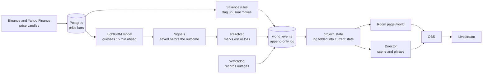
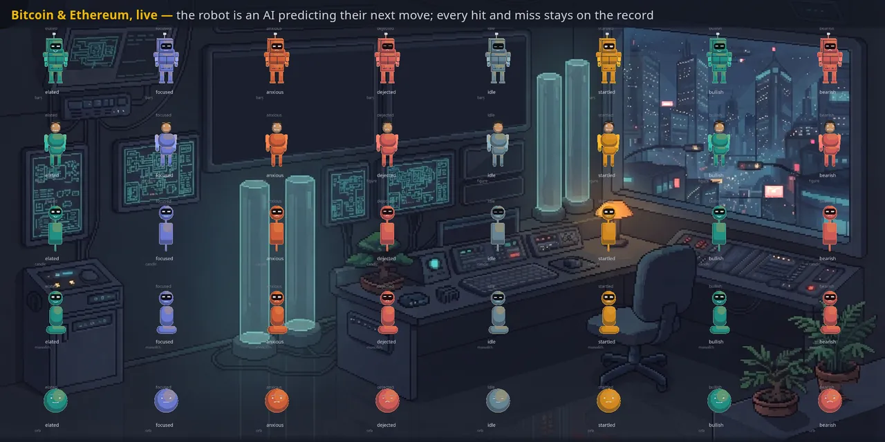

# Bitcoin Room

[](https://github.com/keyhot/market-data-pipeline/actions/workflows/ci.yml)

A 24/7 livestream where live Bitcoin and Ethereum prices drive a small pixel-art room, and a
prediction model has to show its win/loss record in public.


*Example data. The room page (`/world`) running on made-up prices and events. The art and the
code are the real thing. Made offline with [`tools/readme_shots.py`](tools/readme_shots.py).*

> **Honest status.** The model loses money. Its walk-forward backtest returned **-63.3%**
> while simply holding Bitcoin returned **+18.4%**. That number is published on purpose and
> was never quietly retuned. The goal is a model that wins. This is version zero, and its
> record stays in the log either way. See [the numbers explained](docs/README-details.md#reading-the-numbers).

## How it works in 5 steps

1. **Collect prices.** The app pulls one-minute price candles for Bitcoin and Ethereum from
   Binance, and daily prices for a few stocks from Yahoo Finance. It stores them in a
   Postgres database.
2. **Notice what is unusual.** Simple fixed rules watch the candles. They flag big moves,
   volatility spikes, gaps, streaks and odd trading volume. Each flag is called a *world
   event*.
3. **Remember everything.** World events go into one log table, `world_events`. The log is
   append-only: the code never edits or deletes a row. Wins, losses and outages stay forever.
4. **Predict, then check.** A LightGBM model guesses whether the price will be higher in 15
   minutes. Each guess is saved before the answer is known. 15 minutes later a resolver marks
   it a win or a loss and writes that to the log.
5. **Show it.** The room page turns the log into the current state: moods, tiers, the
   model's record. A "director" picks scenes and lines from fixed phrase banks. There is no
   LLM and no API cost. OBS streams the page.



Because everything on screen is computed from the log, refreshing the page restores the same
world, not a similar one. The fold function, `project_state()`, is property-tested for that.

## What it looks like


*Example data. The `/charts` page. Each arrow is one model call at the minute it was made.
Green is a win, red is a loss, grey is still waiting for its 15 minutes to pass.*



*Example data. The `/world?gallery=1` page. The same characters in each mood the room can
show. The mood comes from recent events in the log.*

## What's inside

| Folder | What it holds |
|---|---|
| `api/` | The FastAPI app, its routes, and the HTML pages (room, charts, overlays) with their JavaScript. |
| `ingestion/` | Price, news and event providers (Binance REST and websocket, Yahoo Finance) and the fetchers that use them. |
| `storage/` | Postgres access, the migration ledger, and optional CSV snapshots. |
| `scheduler/` | Timed background jobs that ingest the watchlist, plus market-hours rules. |
| `world/` | The core idea: salience rules, event types, the resolver, `project_state()`, and the room's visual rules. |
| `model/` | LightGBM features, training, backtest and prediction, plus the research experiments. |
| `director/` | Scene switching and commentary from phrase banks, with optional text-to-speech. |
| `stream/` | The stream watchdog, the OBS scene spec and the uptime (soak) report. |
| `broadcast/` | The YouTube Live broadcast lifecycle. |
| `music/` | The music bed's credits manifest and player. |
| `alerts/` | Rules and a mailer that put failures in front of a person. |
| `schemas/` | Response and enum types shared by the API. |
| `config/` | The watchlist, logging, the freqtrade dry-run config and music credits. |
| `db/` | `init.sql`, the database schema. |
| `scripts/` | Command-line entry points: stream control, backfills, reports, the smoke test. |
| `tools/` | Art and measurement tools, and the script that makes this README's screenshots. |
| `tests/` | The offline test suite and the opt-in integration tests. |
| `docs/` | Design docs that must stay next to the code, and the README images. |

## Run it locally

You need Docker with Compose. For development you also need Python 3.11 or newer and
[Poetry](https://python-poetry.org/) 2.

```bash
cp .env.example .env                # local-development defaults
docker compose up -d --build        # starts Postgres, the API and the scheduler
./scripts/smoke_test.sh             # optional: waits for a stored bar and checks the API
```

Then open:

- <http://localhost:8000/world> for the room
- <http://localhost:8000/charts?interval=1m> for the candlestick charts
- <http://localhost:8000/dashboard> for the watchlist

The scheduler container pulls public Binance and Yahoo Finance data. No API key is needed.
A new database has no memory yet, so the room fills in as events arrive. To give it a past,
replay the same rules over 60 days of history:

```bash
poetry install
poetry run python scripts/backfill_world_events.py --days 60 --dry-run   # drop --dry-run to write
```

To run the API outside Docker, keep Postgres from Compose running and start the server:

```bash
docker compose up -d postgres
poetry run uvicorn api.main:app --reload
```

The model, the stream and the optional services (director, broadcast, trader) are covered in
[docs/README-details.md](docs/README-details.md).

## Tests

```bash
poetry run pytest
```

Use `poetry run pytest`, not bare `pytest`. The default run is offline. It needs no network
and no database: providers, the OBS client and the store are injected fakes, and the suite
refuses any database connection ([`tests/db_guard.py`](tests/db_guard.py)).

The tests in `tests/integration/` are opt-in. They are skipped unless you set
`MDP_TEST_DATABASE_URL` to a throwaway Postgres whose database is named `mdp_test_*` and whose
port is not 5432. `DATABASE_URL` and the `localhost:5432` default are never used. Some of them
also need `POSTGRES_DISPOSABLE=1`. CI does this against a fresh `postgres:16` service and
also runs `ruff check .` ([`ci.yml`](.github/workflows/ci.yml)).

## Learn more

- [docs/README-details.md](docs/README-details.md): the full technical write-up that used to
  be this page. It has the model, the numbers glossary, the stream, every endpoint, the
  settings, and what is not done yet.
- [docs/world-memory.md](docs/world-memory.md): the append-only contract for `world_events`.
- [docs/postgres-schema-spike.md](docs/postgres-schema-spike.md): the design for the Postgres
  storage layer, where every write is an idempotent upsert.
- [docs/freqai-takeaways.md](docs/freqai-takeaways.md): design rules taken from freqtrade's
  FreqAI docs. Ideas only, no code copied.
- [`.env.example`](.env.example): the settings, with comments.

Planning notes and experiment write-ups live in an Obsidian vault outside this repo.
